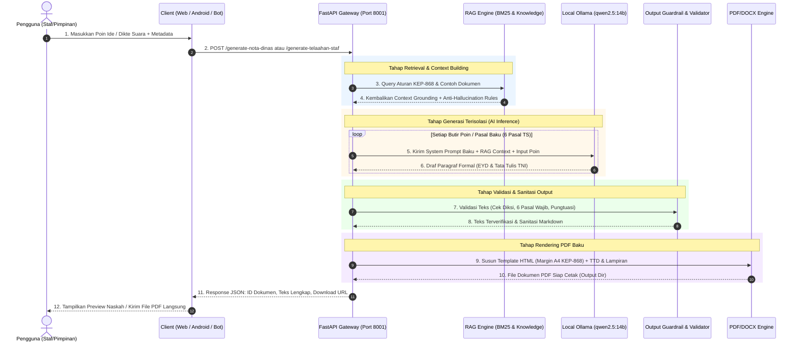

# DOKUMENTASI LENGKAP: FUNGSI, TUJUAN, ARSITEKTUR 3-TIER, DAN WORKFLOW SISTEM
## SISTEM SURAT ELEKTRONIK BERBASIS AI (SSEB AI)
*Platform Tata Naskah Dinas Mandiri, Berdaulat, dan Terstandarisasi KEP/868/2022 TNI*

---

## DAFTAR ISI
1. [Latar Belakang & Urgensi Platform](#1-latar-belakang--urgensi-platform)
2. [Fungsi, Tujuan Utama & Spektrum Naskah Dinas (Nota Dinas, Telaahan Staf, Surat Umum)](#2-fungsi--tujuan-utama-sistem)
3. [Tiga Pilar Antarmuka Sistem (Web, Telegram Bot, Android)](#3-tiga-pilar-antarmuka-sistem-web-telegram-bot-android)
   - [3.1 Web Base Portal (Portal Staf & Operator Desktop)](#31-web-base-portal-portal-staf--operator-desktop)
   - [3.2 Bot Telegram (Asisten Komando & Pembuatan Naskah Jarak Jauh)](#32-bot-telegram-asisten-komando--pembuatan-naskah-jarak-jauh)
   - [3.3 Aplikasi Android Mobile (Mobilitas Personel Lapangan & Taktis)](#33-aplikasi-android-mobile-mobilitas-personel-lapangan--taktis)
4. [Standar Baku Telaahan Staf / Kajian (KEP/868/IX/2022 Contoh 26)](#4-standar-baku-telaahan-staf--kajian-kep868ix2022-contoh-26)
5. [Arsitektur Engine AI & Sistem Anti-Halusinasi](#5-arsitektur-engine-ai--sistem-anti-halusinasi)
6. [Workflow Penuh Sistem (End-to-End Flow)](#6-workflow-penuh-sistem-end-to-end-flow)
   - [6.1 Diagram Alur Global (Mermaid Sequence)](#61-diagram-alur-global-mermaid-sequence)
   - [6.2 Tahapan 1: Penerimaan & Ekstraksi Input (Input Stage)](#62-tahapan-1-penerimaan--ekstraksi-input-input-stage)
   - [6.3 Tahapan 2: Retrieval & Grounding Regulasi KEP-868 (RAG Stage)](#63-tahapan-2-retrieval--grounding-regulasi-kep-868-rag-stage)
   - [6.4 Tahapan 3: Inferensi AI Lokal & Isolasi Paragraf / Pasal (Generation Stage)](#64-tahapan-3-inferensi-ai-lokal--isolasi-paragraf--pasal-generation-stage)
   - [6.5 Tahapan 4: Guardrail & Output Validation (Sanitization Stage)](#65-tahapan-4-guardrail--output-validation-sanitization-stage)
   - [6.6 Tahapan 5: Penyusunan Template & Render PDF Baku (Rendering Stage)](#66-tahapan-5-penyusunan-template--render-pdf-baku-rendering-stage)
   - [6.7 Tahapan 6: Distribusi, Preview & Pengesahan (Distribution Stage)](#67-tahapan-6-distribusi-preview--pengesahan-distribution-stage)
7. [Matriks Komparasi Antarmuka (Feature Matrix)](#7-matriks-komparasi-antarmuka-feature-matrix)
8. [Kesimpulan & Nilai Tambah Operasional](#8-kesimpulan--nilai-tambah-operasional)

---

## 1. LATAR BELAKANG & URGENSI PLATFORM

Dalam ekosistem militer (seperti lingkungan TNI dan Pusat Siber Pertahanan) serta instansi pemerintahan, **Tata Naskah Dinas** (Nota Dinas, Surat Resmi, Surat Perintah, Laporan Kesiapan) merupakan tulang punggung kendali komando, koordinasi staf, dan legalitas operasional.

### Permasalahan Nyata di Lapangan:
1. **Inefisiensi Waktu**: Personel dan perumus naskah rata-rata membutuhkan waktu 30 hingga 90 menit per dokumen hanya untuk merangkai kalimat formal, merapikan struktur margin, dan menyusun hierarki penomoran sub-poin.
2. **Resiko Ketidakpatuhan Format (Format Non-Compliance)**: Kesalahan margin, format tanggal, penulisan nama/pangkat/NRP, serta kesalahan kalimat penutup yang tidak sesuai dengan **Keputusan Panglima TNI Nomor KEP/868/IX/2022** sering mengakibatkan surat ditolak (*revisi berulang*).
3. **Resiko Kebocoran Dokumen Rahasia (Data Leakage)**: Penggunaan AI komersial publik berbasis cloud (seperti ChatGPT atau Gemini publik) untuk naskah kedinasan beresiko fatal membocorkan data intelijen dan strategi militer ke server pihak ketiga di luar negeri.
4. **Hambatan Mobilitas Komando**: Ketika pimpinan atau staf sedang bertugas di luar kantor / dinas luar, pembuatan naskah dinas darurat sering terhambat karena ketiadaan laptop atau workstation kantor.

**Sistem Surat Elektronik Berbasis AI (SSEB AI)** hadir sebagai solusi kedaulatan digital (*Sovereign AI*) yang 100% berjalan secara lokal (On-Premises / Air-Gapped Intranet) tanpa bergantung pada internet publik, dengan kepatuhan tata naskah 100% otomatis.

---

## 2. FUNGSI & TUJUAN UTAMA SISTEM

### A. Fungsi Utama Sistem
- **Automated Drafting Engine**: Mengubah poin-poin ide pokok singkat (atau rekaman suara) menjadi redaksi naskah resmi berbahasa Indonesia baku sesuai kaidah militer hanya dalam hitungan detik.
- **Strict Grounding RAG**: Memastikan setiap kata, diksi, hierarki nomor, dan struktur surat merujuk langsung pada pedoman baku KEP/868/2022 dan arsip naskah dinas resmi.
- **Zero-Hallucination Guardrail**: Membatasi model AI agar tidak pernah mengarang regulasi fiktif, nama pejabat palsu, tanggal acak, atau angka di luar data input pengguna.
- **Multi-Format Precise Rendering Engine**: Menghasilkan dokumen PDF dan DOCX siap cetak dengan margin militer presisi (20.3mm / 25.4mm / 12.7mm / 15.2mm) dan tipografi Arial 12pt Justified.
- **Omnichannel Access**: Menyediakan akses terpadu melalui Web Desktop, Bot Telegram, dan Aplikasi Android Mobile.

### B. Tujuan Strategis Sistem
1. **Memangkas Waktu Perumusan Dokumen hingga 90%**: Dari 30–60 menit menjadi kurang dari 5 detik untuk menghasilkan draf siap verifikasi.
2. **Menjamin 100% Kepatuhan Regulasi KEP/868/2022**: Mengunci struktur kop, metadata, penomoran dasar bertingkat (`a., b., c.`), isi bertingkat (`2., 3., 4.`), tanda baca baku (`;`, `; dan`, `.`), serta penutup hierarkis.
3. **Menjaga Kedaulatan & Keamanan Data (Zero Cloud Leakage)**: Seluruh pemrosesan AI, database, dan file dokumen berada di perimeter jaringan tertutup (intranet).
4. **Memudahkan Pengambilan Keputusan Cepat**: Memberikan sarana bagi pimpinan dan staf untuk menyusun, meninjau, dan menyebarkan nota dinas langsung dari smartphone di mana saja dan kapan saja.

---

## 3. TIGA PILAR ANTARMUKA SISTEM (WEB, TELEGRAM BOT, ANDROID)

Sistem dirancang dengan arsitektur **Tri-Platform** terintegrasi, di mana setiap platform memiliki fungsi spesifik sesuai konteks kebutuhan personel:

```
                  ┌─────────────────────────────────────────┐
                  │          SSEB AI CORE ENGINE            │
                  │   FastAPI + Local Ollama (qwen2.5:14b)  │
                  │       + RAG KEP-868 + PDF Service       │
                  └────────────────────┬────────────────────┘
                                       │
         ┌─────────────────────────────┼─────────────────────────────┐
         ▼                             ▼                             ▼
┌──────────────────┐         ┌───────────────────┐         ┌──────────────────┐
│    WEB PORTAL    │         │   BOT TELEGRAM    │         │  ANDROID NATIVE  │
│ (Desktop/Office) │         │ (Remote/Command)  │         │ (Mobile/Field)   │
└──────────────────┘         └───────────────────┘         └──────────────────┘
```

---

### 3.1 Web Base Portal (Portal Staf & Operator Desktop)

**Peran & Target Pengguna**: Operator Tata Usaha (TU), Sekretariat Satker, dan Staf Administrasi yang bekerja menggunakan workstation/PC kantor.

#### Fitur & Karakteristik Utama:
1. **Formulir Interaktif Komprehensif**:
   - Pilihan jenis dokumen: Nota Dinas Baku atau Surat Resmi/Dinas.
   - Konfigurasi Kop Satuan (Kop Utama & Kop Satuan Bawah).
   - Penomoran surat, input tujuan (Kepada Yth), pengirim (Dari), dan perihal.
   - Pilihan hierarki kalimat penutup: *"mohon menjadi periksa"* (ke Atasan) vs *"mohon menjadi perhatian"* (ke Sejajar/Bawahan).
   - Input dasar hukum dinamis multi-baris (otomatis dikonversi ke sub-poin `a.`, `b.`, dst.).
   - Input poin isi dinamis dengan dukungan sub-poin rincian.
2. **Fitur Pratinjau & Editor Naskah Interaktif (Interactive Document Preview & Live Edit)**:
   - Menampilkan teks draf hasil formulasi AI dalam **area editor langsung** (*in-place editable textarea*).
   - Pengguna dapat leluasa mengoreksi kata, mengubah kalimat, atau menambah poin rincian langsung di layar.
   - Dilengkapi tombol **"Simpan Editan & Render PDF"**: Server merender ulang dokumen PDF resmi secara instan menggunakan teks yang telah diedit pengguna.
   - Menampilkan statistik jumlah karakter & kata secara *real-time*, serta notifikasi visual bila terdapat perubahan yang belum disimpan.
   - Tombol **"Salin Teks"** untuk menyalin redaksi draf ke *clipboard*.
3. **One-Click Download & Print**:
   - Ekspor langsung ke PDF A4 beresolusi tinggi (standar KEP/868/2022).
   - Buka pratinjau PDF di tab baru atau download langsung.
4. **RAG & Knowledge Center Monitoring**:
   - Status sinkronisasi RAG, indikator anti-halusinasi, dan tombol re-index dokumen master.

---

### 3.2 Bot Telegram (Asisten Komando & Pembuatan Naskah Jarak Jauh)

**Peran & Target Pengguna**: Perwira Staf, Pimpinan, dan Personel Luar yang membutuhkan akses cepat via aplikasi perpesanan instan tanpa perlu membuka browser atau menginstal aplikasi tambahan.

#### Fitur & Karakteristik Utama:
1. **Interaksi Berbasis Dialog / Wizard (/surat & /notadinas)**:
   - Bot memandu pengguna langkah demi langkah melalui chat interaktif (Kop, Nomor, Tujuan, Pengirim, Perihal, Dasar, dan Poin Pokok).
2. **Fitur Pratinjau Draf & Edit Redaksi Langsung di Chat (In-Chat Document Preview & Edit)**:
   - Setelah AI menyusun draf naskah, bot **TIDAK langsung mencetak PDF**, melainkan menyajikan **Pesan Pratinjau Draf Naskah Lengkap** di ruang chat.
   - Dilengkapi menu tombol interaktif (*inline keyboard*):
     - 📥 **"✅ Setuju & Unduh PDF"**: Menyetujui draf dan langsung menerima file dokumen PDF resmi.
     - ✏️ **"📝 Edit Redaksi Teks"**: Mengaktifkan mode edit, pengguna cukup membalas (*reply*) dengan teks revisi baru, dan bot otomatis memperbarui draf pratinjau.
     - 🔄 **"🔄 Generate Ulang AI"**: Memerintahkan AI untuk menyusun ulang redaksi dengan formulasi alternatif.
     - ❌ **"❌ Batalkan"**: Membatalkan proses pembuatan naskah.
3. **Pengiriman Dokumen PDF Langsung di Chat**:
   - Dokumen PDF resmi siap cetak langsung dikirimkan ke ruang obrolan Telegram setelah disetujui, siap diteruskan (*forward*) ke grup pimpinan atau staf.
4. **Perintah Kontrol & Manajemen RAG**:
   - `/start` - Menampilkan menu utama & tutorial.
   - `/rag` - Menampilkan status RAG, jumlah dokumen terindeks, dan status anti-halusinasi.
   - `/reindex` - Memerintahkan server untuk melakukan re-indexing dokumen baru.
   - `/carireferensi <kata_kunci>` - Melakukan pencarian semantik terhadap arsip naskah dinas lama.
5. **Aman & Terenkripsi**:
   - Beroperasi melalui token terenkripsi dalam perimeter intranet/VPN satuan.

---

### 3.3 Aplikasi Android Mobile (Mobilitas Personel Lapangan & Taktis)

**Peran & Target Pengguna**: Personel Lapangan, Komandan Satuan Bergerak, Inspektur Operasional, dan Perwira yang sering berdinas di luar ruangan.

#### Fitur & Karakteristik Utama:
1. **Antarmuka Modern Native (Kotlin + Jetpack Compose & Material 3)**:
   - Tampilan responsif, bertema formal militer, mendukung Dark Mode & Light Mode.
   - Navigasi *Bottom Bar* 3 Tab: **Buat Baru (Generate)**, **Arsip & Draf**, dan **Pengaturan**.
2. **Fitur Pratinjau & Dialog Editor Naskah (In-App Document Preview & Editor Modal)**:
   - Tombol **"🔍 Pratinjau & Edit"**: Mengambil draf redaksi hasil AI dan membuka jendela editor interaktif.
   - Pengguna dapat meninjau naskah secara menyeluruh dan mengedit kalimat atau angka secara langsung di layar smartphone.
   - Tombol **"💾 Simpan & Render PDF"**: Mengirim teks hasil editan ke backend untuk dikompilasi menjadi dokumen PDF berformat presisi KEP/868/2022.
   - Tombol **"⚡ Generate PDF"**: Memungkinkan opsi *fast-track* untuk membuat PDF secara langsung jika pengguna tidak memerlukan penyesuaian manual.
3. **Dikte Suara (Speech-to-Text Input)**:
   - Pengguna cukup menekan ikon mikrofon dan mendiktekan poin-poin naskah secara lisan, yang otomatis dikonversi menjadi poin terstruktur.
4. **Progressive Disclosure & Sub-Poin Dinamis**:
   - Kemudahan menambah poin isi (`1`, `2`, `3`) dan sub-poin (`a`, `b`, `c`) secara instan melalui tombol aksi cepat.
5. **Native Android PDF Viewer & In-App Preview**:
   - Pratinjau dokumen PDF langsung di layar ponsel dengan dukungan *pinch-to-zoom*, serta tombol **"Edit Naskah"** pada bilah atas (*TopAppBar*) untuk kembali menyunting kapan saja.
6. **Android Share Sheet & Wi-Fi Direct Printing**:
   - Mengirim PDF langsung ke aplikasi dinas (Telegram, Signal, WhatsApp Dinas) dengan satu sentuhan.
   - Mencetak naskah langsung ke printer nirkabel via *Android PrintManager API*.
7. **Keamanan Sandbox & Autentikasi Biometrik**:
   - Proteksi sidik jari / Face Unlock saat membuka aplikasi.
   - Penyimpanan draf terenkripsi menggunakan *Room Database + SQLCipher (AES-256)*.
8. **Arsitektur Hybrid AI**:
   - *Intranet Mode*: Terhubung ke server pusat (`qwen2.5:14b`) untuk redaksi maksimal saat terhubung ke Wi-Fi kantor.
   - *Offline / On-Device Mode*: Mampu beralih ke model lokal kecil di dalam ponsel ketika berada di area blank-spot/air-gapped.

---

## 4. STANDAR BAKU TELAAHAN STAF / KAJIAN (KEP/868/IX/2022 CONTOH 26)

Dalam tata tulis militer TNI, dokumen kajian dibakukan sebagai **TELAAHAN STAF** (*Tulisan Dinas di Luar Tataran*) yang berfungsi menyampaikan analisis mendalam dan usulan cara bertindak terbaik kepada pimpinan untuk memecahkan suatu persoalan.

### A. Anatomi & Struktur Dokumen Baku
1. **Tipografi & Margin Kertas A4**:
   - Font: Arial 12pt, Single line spacing, Rata Kiri-Kanan (*Justified*).
   - Margin: Top 2.03 cm (0.8"), Left 2.54 cm (1.0"), Bottom 12.7 mm (0.5"), Right 15.2 mm (0.6").
2. **Kelompok Kepala**:
   - Kop Nama Badan / Satuan di sudut kiri atas dengan garis penutup selebar teks terpanjang.
   - Judul simetris di tengah: `TELAAHAN STAF`, `TENTANG`, `[JUDUL KAJIAN KAPITAL]`, dan `Nomor TS/...`.
3. **Kelompok Isi (6 Pasal Baku Pemecahan Masalah)**:
   - **1. Persoalan.** Memuat pernyataan singkat dan jelas tentang persoalan yang akan dipecahkan.
   - **2. Praanggapan.** Memuat dugaan beralasan berdasarkan data dan kemungkinan di masa depan.
   - **3. Fakta/Data yang Memengaruhi.** Landasan fakta/data konkret analisis persoalan.
   - **4. Analisis.** Kupasan pengaruh fakta & praanggapan, hambatan, keuntungan/kerugian cara bertindak.
   - **5. Kesimpulan.** Intisari hasil telaah dan penetapan 1 pilihan cara bertindak terbaik.
   - **6. Saran.** Usulan tindakan ringkas dan konkret untuk pimpinan mengatasi persoalan.
4. **Kelompok Penutup**:
   - Tanda tangan di kanan bawah (Tempat, Tanggal, Tajuk Jabatan `Perwira Staf,`, Nama Terang berakhiran titik, dan Pangkat/Korps/NRP).
   - Sisi kiri bawah sejajar tajuk tanda tangan: `Lampiran:` (diakhiri titik dua) memuat daftar dokumen pendukung.

---

## 5. STANDAR BAKU & ARSITEKTUR DETERMINISTIK LAPJU BELANJA MODAL (NON-AI / ZERO-AI MANIPULATION)

Dalam administrasi pertanggungjawaban keuangan dan pelaporan fisik pengadaan barang/jasa TNI, **Laporan Kemajuan (LAPJU) Belanja Modal** merupakan naskah dinas resmi yang sangat vital dan tunduk pada kepatuhan audit BPK/Itjen TNI.

### A. Rationale Arsitektur: Mengapa Modul LAPJU 100% Non-AI?
1. **Integritas Angka & Akuntabilitas Keuangan (Zero-Hallucination Guarantee)**: Data yang dimasukkan (Nomor DIPA, Nilai Pagu, Nilai Kontrak, Realisasi Serapan, dan Sisa Anggaran) merupakan **data riil dan sah secara hukum**. Model AI / LLM dilarang keras memparafrase, membulatkan, menginterpolasi, atau mengarang nominal angka tersebut.
2. **Kalkulasi Matematis Deterministik**:
   - `Sisa Anggaran = Pagu Anggaran - Realisasi Anggaran Terserap`
   - `Rata-rata Kemajuan Fisik (%) = Σ(Persentase Fisik Item) / N`
   - `Rata-rata Kemajuan Administrasi (%) = Σ(Persentase Admin Item) / N`
   - Format Rupiah Baku TNI: Pemisah ribuan titik (`.`), bilangan bulat tanpa desimal sen, atau diakhiri desimal koma presisi.
3. **Penyajian Data Verbatim**: Setiap catatan tahapan administrasi (misal: *BAP Uang Muka 30% Terbit*) dan tahapan fisik (misal: *Pengiriman Batch 1 ke Gudang Satker*) dicetak apa adanya tanpa penambahan diksi fiktif.

### B. Format Naskah Terpadu (Dual-Orientation Integrated PDF)
Modul LAPJU menghasilkan satu dokumen PDF terpadu yang memadukan dua orientasi kertas berbeda:
1. **Halaman 1 (Portrait A4 - KEP/868/2022)**:
   - Naskah Induk Surat Pengantar resmi Kepala Satker/Dinas.
   - Memuat Kop Satker, Nomor Surat Romawi otomatis, Klasifikasi, Lampiran, Perihal, Alamat Kepada Yth, 2 Pasal Baku Surat Pengantar, serta Tajuk Tanda Tangan Definitif / Mewakili (`mewakili,`).
   - Dilengkapi Tembusan berjenjang dan Tabel Paraf Koordinasi Internal.
2. **Halaman 2+ (Landscape A4 - Matriks Tabel 13 Kolom Realisasi)**:
   - Kop Lampiran resmi di sudut kanan atas.
   - Judul simetris: `LAPORAN KEMAJUAN PELAKSANAAN KEGIATAN BELANJA MODAL [SATKER] PERIODE BULAN [BULAN] TA. [TAHUN]`.
   - **Tabel Matriks 13 Kolom Baku**:
     - Kolom (1): Nomor Urut
     - Kolom (2)-(3): Nomor & Tanggal DIPA
     - Kolom (4): Program / Kegiatan / KRO / RO / Komponen / Akun / Item
     - Kolom (5): Pagu Anggaran (Rp)
     - Kolom (6)-(10): Kontrak (Nilai Rp, Nomor, Tanggal, Target Deadline Selesai/TDS, dan Nama Rekanan/Penyedia)
     - Kolom (11)-(12): Realisasi Anggaran Terserap & Sisa Anggaran (Rp)
     - Kolom (13)-(14): Kemajuan Fisik (%) & Administrasi (%)
     - Kolom (15): Keterangan Tahapan (Admin & Fisik)
   - Baris Rekapitulasi Jumlah / Total Keseluruhan di baris penutup.
   - Tajuk Tanda Tangan Pengesahan Lampiran di kanan bawah.

---

## 6. ARSITEKTUR ENGINE AI & SISTEM ANTI-HALUSINASI

Untuk menjamin keandalan 100% di lingkungan militer, sistem menerapkan arsitektur **5 Lapisan Pertahanan Anti-Halusinasi**:

```
┌───────────────────────────────────────────────────────────────────────────┐
│              ARSITEKTUR PERTAHANAN ANTI-HALUSINASI SSEB AI                │
├───────────────────────────────────────────────────────────────────────────┤
│                                                                           │
│ [LAPISAN 1] KNOWLEDGE BASE GROUNDING                                      │
│  - Dokumen Master KEP/868/2022 (Struktur, Margin, Font, Penomoran Baku)   │
│  - File Dokumen Aturan Anti-Halusinasi & Kamus Diksi Militer              │
│  - 50+ Sampel Naskah Dinas Riil Satuan                                    │
│                                  ↓                                        │
│ [LAPISAN 2] RAG CONTEXT INJECTION (BM25 + Semantic Boosting)              │
│  - Ekstraksi aturan wajib & contoh analog paling relevan                  │
│  - Injeksi otomatis ke GENERATOR NOTA DINAS & SURAT (100% Grounded)       │
│  - Auto-Budget Context (Trim otomatis agar tidak melebihi memory window)  │
│                                  ↓                                        │
│ [LAPISAN 3] HARDENED SYSTEM & USER PROMPTS                                │
│  - 10 Larangan Mutlak (Dilarang mengarang nama, pasal, regulasi, tanggal) │
│  - Isolated Paragraph Generation (Generasi per butir poin tanpa repetisi) │
│  - Penegasan "INSTRUKSI FINAL" di akhir prompt                            │
│                                  ↓                                        │
│ [LAPISAN 4] PARAMETER INFERENSI ULTRA-DETERMINISTIK                       │
│  - Temperature = 0.1 (Menghilangkan deviasi/kreativitas liar model)       │
│  - Top-P = 0.85 & Top-K = 40 (Nucleus filtering)                          │
│  - Repeat Penalty = 1.15 (Mencegah perulangan frasa)                      │
│                                  ↓                                        │
│ [LAPISAN 5] OUTPUT VALIDATION & GUARDRAIL SANITIZER                       │
│  - Regex Filter: Deteksi regulasi palsu, nama perwira fiktif, tgl karangan│
│  - Verbosity Guard: Potong teks jika melebihi batas 500 kata              │
│  - Fallback Deterministik jika server timeout/offline                     │
│                                                                           │
└───────────────────────────────────────────────────────────────────────────┘
```

---

## 7. WORKFLOW PENUH SISTEM (END-TO-END FLOW)

### 7.1 Diagram Alur Global (Mermaid Sequence)

Berikut adalah diagram alur lengkap interaksi antara Pengguna, Antarmuka Klien, Server Backend, RAG Engine, Local LLM, dan PDF Engine:



---

### 7.2 Tahapan 1: Penerimaan & Ekstraksi Input (Input Stage)

1. **Pengguna Mengisi Parameter Naskah**:
   - **Jenis Naskah**: Nota Dinas Baku, Telaahan Staf (6 Pasal), atau Surat Resmi.
   - **Kop Satker**: Contoh `PUSAT SIBER PERTAHANAN` / `SATUAN PENGAMANAN SIBER`.
   - **Metadata Identitas**: Nomor Naskah (Auto/Manual), Kepada Yth, Dari, Judul/Perihal.
   - **Untuk Nota Dinas**: Dasar hukum bertingkat dan poin isi ringkas.
   - **Untuk Telaahan Staf**: Poin Persoalan, Praanggapan, Fakta, Analisis, Kesimpulan, dan Saran.
   - **Penandatangan**: Nama Pejabat, Pangkat/Korps/NRP, Tajuk Jabatan, dan Daftar Lampiran.
2. **Klien Membungkus Data**: Data divalidasi oleh model klien (Pydantic / Kotlin Data Class) dan dikirim via REST API ke endpoint `/draft-telaahan-staf` atau `/generate-telaahan-staf`.

---

### 7.3 Tahapan 2: Retrieval & Grounding Regulasi KEP-868 (RAG Stage)

1. **RAG Context Request**: Backend menerima payload, lalu memanggil `get_telaahan_staf_context()` atau `rag_engine.get_nota_dinas_context()`.
2. **Semantic Search & Document Retrieval**:
   - RAG Engine memindai indeks BM25 yang mencakup file master `KEP-868-JUKREF-TTM-DI-LINGK-TNI-2022.docx` dan sampel naskah dinas riil.
3. **Injeksi Aturan Anti-Halusinasi & Format Baku**:
   - RAG Engine menambahkan aturan anti-halusinasi dan pakem 6 pasal KEP/868 Contoh 26 pada konteks inferensi.

---

### 7.4 Tahapan 3: Inferensi AI Lokal & Isolasi Paragraf / Pasal (Generation Stage)

Sistem menggunakan teknik **Isolated Section Generation** pada Telaahan Staf:
1. **Pasal 1 (Persoalan)**: Merumuskan inti masalah yang memerlukan pemecahan segera (2-3 kalimat).
2. **Pasal 2 (Praanggapan)**: Merumuskan dugaan beralasan dan peluang ke depan (2-3 kalimat).
3. **Pasal 3 (Fakta)**: Merumuskan data konkret dan kondisi lapangan tanpa melebih-lebihkan (2-4 kalimat).
4. **Pasal 4 (Analisis)**: Mengupas pengaruh fakta, hambatan, keuntungan/kerugian cara bertindak (3-5 kalimat).
5. **Pasal 5 (Kesimpulan)**: Menetapkan satu cara bertindak terbaik yang paling feasible (2-3 kalimat).
6. **Pasal 6 (Saran)**: Menyampaikan usulan tindakan konkret untuk pimpinan (2-3 kalimat).

---

### 7.5 Tahapan 4: Guardrail & Output Validation (Sanitization Stage)

Modul sanitasi `validate_and_sanitize_telaahan_staf()`:
1. **Verifikasi 6 Pasal Baku**: Memastikan seluruh 6 pasal terisi lengkap tanpa ada yang tertinggal.
2. **Pembersihan Artefak Markdown**: Menghilangkan tanda bintang (`**`), heading (`##`), bullet points (`-`), dan nomor pasal duplikat.
3. **Standardisasi Diksi Militer**: Memastikan nada bicara lugas, objektif, dan formal.

---

### 7.6 Tahapan 5: Penyusunan Template & Render PDF Baku (Rendering Stage)

1. **Penyusunan Template Jinja2**:
   - Menggunakan template `telaahan_staf_template.html` dengan margin A4 presisi (Top 2.03 cm, Left 2.54 cm, Bottom 12.7 mm, Right 15.2 mm).
   - Judul simetris di tengah: `TELAAHAN STAF`, `TENTANG`, `[JUDUL]`, dan `Nomor TS/...`.
   - Judul pasal ditebalkan (*bold*) sejajar teks (*inline*).
   - Tanda tangan di kanan bawah, dan `Lampiran:` di sisi kiri bawah sejajar tajuk tanda tangan.
2. **Rendering PDF**:
   - Dikonversi menggunakan `wkhtmltopdf` ke direktori terisolasi `backend/output/`.

---

### 7.7 Tahapan 6: Distribusi, Preview & Pengesahan (Distribution Stage)

1. **Web Base Portal**: Menampilkan pratinjau draf di editor langsung, live editing, dan satu klik cetak PDF.
2. **Bot Telegram**: Menampilkan pratinjau teks 6 pasal di chat room dengan inline button `[✅ Setuju & Unduh PDF]`, `[✏️ Edit Redaksi]`, `[🔄 Generate Ulang]`.
3. **Android Client**: Menampilkan preview naskah dengan dukungan Speech-to-Text (STT) dan penyimpanan lokal Room DB.

---

## 8. MATRIKS KOMPARASI ANTARMUKA (FEATURE MATRIX)

| Fitur / Kemampuan | Web Base Portal | Bot Telegram | Aplikasi Android Native |
|---|:---:|:---:|:---:|
| **Target Perangkat** | Desktop / Laptop PC | Smartphone & Desktop | Smartphone & Tablet Android |
| **Metode Input** | Formulir Web Lengkap | Percakapan Chat / Dialog | Form Dinamis + Dikte Suara (STT) |
| **Dukungan Nota Dinas** | ✅ Lengkap (Dasar + Poin) | ✅ Wizard `/notadinas` | ✅ Lengkap + Dynamic Subpoin |
| **Dukungan Telaahan Staf (6 Pasal)** | ✅ Lengkap (6 Pasal Form) | ✅ Wizard `/kajian` | ✅ Lengkap + Voice STT Mic |
| **Dukungan Surat Umum** | ✅ Lengkap | ✅ Wizard `/surat` | ✅ Lengkap |
| **Dukungan LAPJU Belanja Modal (Data Riil / Non-AI)** | ✅ Lengkap (Matriks 13 Kolom) | ✅ Wizard `/lapju` | ✅ Lengkap + Real-time KPI Card |
| **Live Editor Teks** | ✅ Ada (Full WYSIWYG) | ✅ Ada (In-Chat Edit) | ✅ Ada (Editor Draf Modal) |
| **Pratinjau PDF** | ✅ Browser In-Tab | ✅ Download File Chat | ✅ Native In-App Zoomable Preview |
| **Berbagi Langsung (Share)** | Download Manual | Forward Chat Telegram | Android Native Share Sheet |
| **Direct Wi-Fi Printing** | Browser Print Dialog | ❌ Perlu Aplikasi Tambahan | ✅ Android PrintManager Terintegrasi |
| **Penyimpanan Draf Lokal** | ❌ (Sesi Browser) | ❌ (Riwayat Chat) | ✅ Room DB + SQLCipher (Enkripsi) |
| **Autentikasi Biometrik** | ❌ Akun Login Web | ❌ PIN / ID Telegram | ✅ Sidik Jari & Pengenalan Wajah |
| **Kemampuan Operasi Offline** | ❌ Perlu Jaringan Lokal | ❌ Perlu Jaringan Telegram | ✅ Hybrid (Intranet + On-Device AI) |

---

## 9. KESIMPULAN & NILAI TAMBAH OPERASIONAL

**Sistem Surat Elektronik Berbasis AI (SSEB AI)** merevolusi tata kelola administrasi naskah dinas militer dan pemerintahan dengan menggabungkan tiga pilar utama:
1. **Kecepatan Ekstrem**: Memangkas birokrasi pengetikan dari hitungan jam menjadi hitungan detik.
2. **Kepatuhan Mutlak**: Mengeliminasi kesalahan penulisan dan tata letak dengan mengunci standar **KEP/868/2022 TNI (Nota Dinas & Telaahan Staf Contoh 26)**.
3. **Kedaulatan & Keamanan Tertinggi**: Menjamin tidak ada data naskah dinas yang bocor ke internet publik dengan implementasi *On-Premises Local LLM* dan *Air-Gapped Hybrid Architecture*.

Dengan tersedianya tiga antarmuka terpadu (**Web Portal** untuk staf meja kerja, **Bot Telegram** untuk koordinasi komando jarak jauh, dan **Aplikasi Android** untuk personel taktis di lapangan), platform ini siap menjadi standar baru administrasi digital terintegrasi masa depan.

---

*Dokumen ini merupakan panduan resmi konsep arsitektur, fungsi, tujuan, dan alur operasional Sistem Surat Elektronik Berbasis AI (SSEB AI).*
