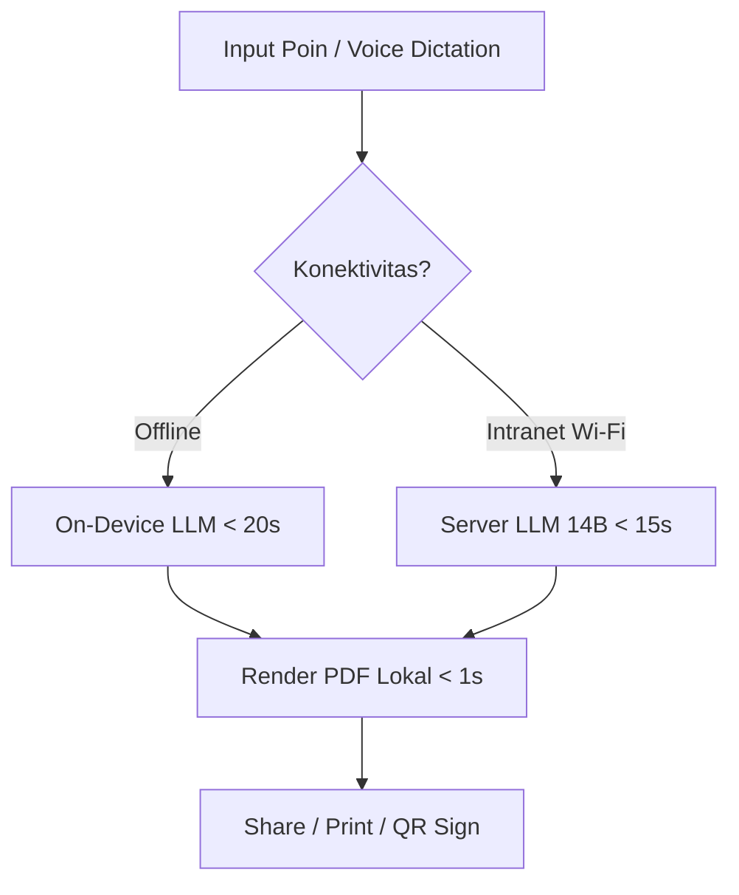
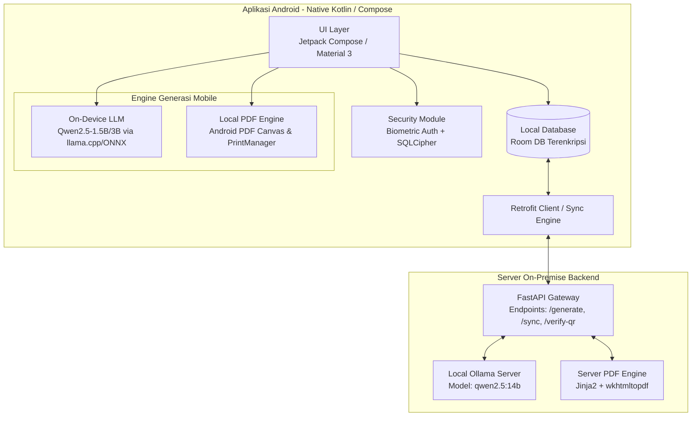
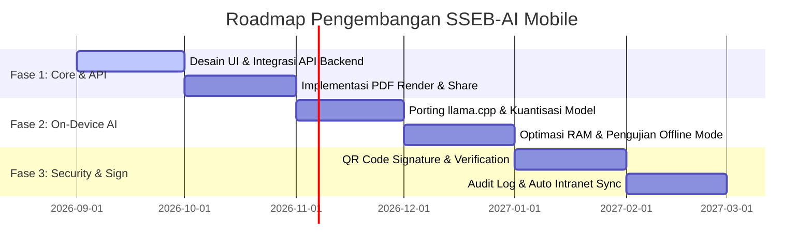

# Product Requirement Document (PRD)
# LLM Surat & Nota Dinas Generator Mobile — SSEB-AI Mobile

---

## 1. Executive Summary & Overview

| Metadata | Keterangan |
|---|---|
| **Nama Produk** | LLM Surat & Nota Dinas Generator Mobile (SSEB-AI Mobile) |
| **Versi Dokumen** | 2.0.0-alpha |
| **Status** | In-Development / Migration to Mobile |
| **Target Pengguna** | Staf Tata Usaha, Sekretariat, dan Personel Administrasi Pusat Komando Operasi & Satuan Pelaksana |
| **Klasifikasi Keamanan** | Terbatas / Internal On-Premise (100% Offline & Air-Gapped Mobile Capable) |
| **Platform** | Android Mobile Application (Native Kotlin / Jetpack Compose) |

### Ringkasan Produk
**LLM Surat & Nota Dinas Generator Mobile** adalah evolusi platform SSEB-AI ke ranah perangkat bergerak (*mobile device*). Aplikasi Android ini dirancang khusus untuk memudahkan personel kedinasan dan administrasi menyusun **Surat Resmi** dan **Nota Dinas Baku** langsung dari smartphone atau tablet mereka. Menggunakan arsitektur *hybrid*, aplikasi ini dapat melakukan inferensi secara offline menggunakan *On-Device LLM* (untuk situasi lapangan tanpa sinyal) maupun terhubung ke server intranet lokal via Wi-Fi terenkripsi untuk memanfaatkan model yang lebih besar. Hasil akhir berupa dokumen PDF resmi yang sesuai dengan Tata Naskah Dinas kedinasan/militer, siap dibagikan melalui aplikasi pesan instan aman atau dicetak langsung via printer nirkabel.

---

## 2. Latar Belakang & Masalah (Problem Statement)

### 2.1 Masalah yang Dihadapi
1. **Keterbatasan Mobilitas Personel**: Staf administrasi dan pimpinan sering kali melakukan dinas luar atau inspeksi lapangan di mana mereka tidak memiliki akses ke workstation desktop, namun dituntut untuk segera menerbitkan nota dinas atau surat keputusan.
2. **Kesulitan Mengetik Panjang di Layar Sentuh**: Mengetik draf surat formal yang panjang menggunakan keyboard virtual smartphone sangat melelahkan, lambat, dan rentan terhadap kesalahan ketik (*typo*).
3. **Ketiadaan Infrastruktur Cloud di Area Sensitif**: Di area operasional militer yang terisolasi atau ruang rapat rahasia (*air-gapped*), tidak ada akses internet ke layanan AI komersial (seperti ChatGPT/Claude), sehingga memerlukan solusi pemrosesan AI lokal pada genggaman tangan.
4. **Alur Validasi & Penandatanganan yang Lambat**: Proses persetujuan naskah dinas tertunda karena atasan harus kembali ke meja kerja untuk membaca draf, memberikan paraf, dan menandatangani dokumen fisik.

### 2.2 Solusi yang Diberikan
Aplikasi Android mandiri (*native*) yang:
- **Mengusung Konsep Mobile-First**: Menyediakan antarmuka input berbasis poin-poin minimalis (*progressive disclosure*) dan mendukung pendiktean suara (*speech-to-text*).
- **Arsitektur Hybrid AI (On-Device & On-Premise)**: Mampu berjalan 100% offline dengan model AI kecil di dalam ponsel, atau beralih secara otomatis ke server lokal saat terhubung ke Wi-Fi intranet instansi.
- **Persetujuan Cepat (Quick Review & Sign)**: Memungkinkan atasan langsung membaca pratinjau (*preview*) dokumen PDF di smartphone dan membubuhkan paraf atau QR Code validasi instan.
- **Keamanan Tingkat Militer**: Menyimpan draf dan dokumen terunduh di dalam *sandbox* aplikasi yang terenkripsi menggunakan biometrik perangkat.

---

## 3. Visi Produk & Sasaran (Objectives & Success Metrics)

### 3.1 Visi Produk
Menjadi platform asisten administrasi kedinasan mobile yang portabel, aman, dan responsif, guna menjamin kelancaran komando dan administrasi di lingkungan Satuan Kerja Operasional di mana pun personel berada.

### 3.2 Key Performance Indicators (KPIs)

- **Kecepatan Generasi**: Pembuatan dokumen dari input poin hingga PDF siap pakai selesai dalam waktu **< 30 detik** pada mode intranet dan **< 45 detik** pada mode on-device offline.
- **Kepatuhan Tata Naskah**: **100% kepatuhan format layout** sesuai aturan administrasi militer, terlepas dari apakah PDF dirender oleh server atau aplikasi mobile secara lokal.
- **Adopsi Pengguna**: Mengurangi ketergantungan pada laptop/desktop untuk penyusunan draf surat hingga **60%** bagi personel yang bermobilitas tinggi.

---

## 4. Persona Pengguna & Use Cases

### 4.1 Persona Pengguna

1. **Personel Lapangan / Staf Operasional (Mobile Operator)**
   - *Karakteristik*: Sering bertugas di luar kantor, hanya membawa smartphone atau tablet taktis.
   - *Kebutuhan*: Menyusun nota dinas permohonan logistik, laporan situasi cepat, atau surat pengantar secara cepat tanpa membuka laptop.
2. **Pimpinan / Perwira Penandatangan (Mobile Reviewer & Signer)**
   - *Karakteristik*: Memiliki otoritas pengesahan, selalu berpindah agenda rapat.
   - *Kebutuhan*: Memeriksa draf naskah dinas dari staf lewat handphone, menyetujui, dan menandatanganinya dengan kode QR digital yang sah.
3. **Petugas Pos / Ekspedisi Administrasi (Mobile Dispatcher)**
   - *Karakteristik*: Mengelola distribusi surat fisik maupun digital.
   - *Kebutuhan*: Membagikan dokumen PDF hasil generator langsung ke grup koordinasi aman (Telegram/Signal) atau mencetaknya ke printer terdekat melalui Wi-Fi.

### 4.2 Use Cases Utama
- **UC-01**: Pembuatan Nota Dinas via Input Poin & Dikte Suara (*Speech-to-Text*).
- **UC-02**: Penyusunan Dokumen Secara Offline Menggunakan On-Device LLM.
- **UC-03**: Sinkronisasi Otomatis Draf Dokumen ke Server Pusat saat Terhubung Wi-Fi Intranet.
- **UC-04**: Peninjauan (*Review*) & Pembubuhan QR Code Paraf/Tanda Tangan Elektronik.
- **UC-05**: Pengiriman PDF via Android Share Sheet & Pencetakan Langsung via Wi-Fi Printer.

---

## 5. Arsitektur Sistem & Spesifikasi Teknis

### 5.1 Technology Stack (Mobile & Backend)
- **Mobile Platform**: Android 10.0+ (API Level 29+), ditulis menggunakan **Kotlin** dan **Jetpack Compose** untuk antarmuka deklaratif modern.
- **Local Storage & Security**: **Room Database** yang diperkuat dengan **SQLCipher** (Enkripsi AES-256 tingkat basis data), serta integrasi **Android Biometric Prompt API**.
- **On-Device AI Engine**: **llama.cpp** (melalui JNI bindings) atau **Google MediaPipe LLM Inference API** dengan format model terkuantisasi (misal: `Qwen2.5-3B-Instruct-Q4_K_M.gguf`).
- **Local PDF Generator**: Engine rendering berbasis **Android WebKit (PrintAttributes / PDF Converter)** untuk mengonversi template HTML dinamis lokal menjadi dokumen PDF siap cetak.
- **Backend API Integration**: Retrofit 2 + OkHttp untuk komunikasi RESTful dengan FastAPI server lokal.

---

## 6. Spesifikasi Kebutuhan Fungsional (Functional Requirements)

### FR-1: Manajemen Keamanan & Enkripsi Data Lokal
- **FR-1.1**: Aplikasi wajib meminta autentikasi biometrik (sidik jari atau pengenalan wajah) atau PIN aman setiap kali dibuka dari kondisi *background* maupun *cold start*.
- **FR-1.2**: Seluruh draf surat, metadata dokumen, dan log aktivitas disimpan di dalam Room database lokal yang terenkripsi sepenuhnya menggunakan SQLCipher.
- **FR-1.3**: Proteksi layar (*Screen Protection*): Aplikasi menyediakan opsi untuk mematikan fitur tangkapan layar (*screenshot/screen recording*) guna melindungi kerahasiaan naskah dinas.

### FR-2: Modul Input Cepat & Speech-to-Text
- **FR-2.1**: Antarmuka input dioptimalkan untuk orientasi portrait dengan tombol-tombol yang mudah dijangkau satu tangan.
- **FR-2.2**: Integrasi dengan Android Speech Recognizer (offline-capable) agar pengguna dapat membacakan poin-poin surat secara verbal yang langsung diubah menjadi teks input.
- **FR-2.3**: Formulir input menerapkan *Progressive Disclosure* untuk poin Nota Dinas, memungkinkan pengguna menambah hingga 5 poin secara dinamis dengan menekan satu tombol mengambang (*Floating Action Button*).

### FR-3: Hybrid Generasi AI (On-Device & Server)
- **FR-3.1**: Sistem otomatis mendeteksi koneksi jaringan. Jika terhubung ke Wi-Fi Intranet Dinas, pemrosesan LLM didelegasikan ke Server FastAPI (`qwen2.5:14b`) untuk kualitas redaksi maksimal.
- **FR-3.2**: Jika dalam kondisi offline/air-gapped, aplikasi beralih menggunakan *On-Device LLM* (`qwen2.5:1.5b` atau `3b`) untuk menghasilkan draf teks secara instan tanpa internet.
- **FR-3.3**: Pengguna dapat mengganti mode AI secara manual melalui halaman Pengaturan (*Settings*).

### FR-4: Render PDF Lokal & Integrasi Berbagi (Native Printing & Share)
- **FR-4.1**: Menyertakan modul renderer HTML-ke-PDF internal berbasis Android WebView Print, menghasilkan dokumen PDF dengan margin dan tata letak militer yang presisi.
- **FR-4.2**: Pratinjau PDF bawaan (*Built-in PDF Previewer*) yang lancar dan mendukung interaksi *pinch-to-zoom*.
- **FR-4.3**: Integrasi **Android Share Sheet**: Memungkinkan pengguna langsung mengirimkan file PDF ke aplikasi chat internal (Telegram, Signal, dll.) atau email dinas dengan sekali ketuk.
- **FR-4.4**: Integrasi **Android Print Manager**: Mendukung pencetakan langsung dari handphone ke printer nirkabel (Wi-Fi/Bluetooth) yang terdeteksi di jaringan lokal.

### FR-5: Alur Review & Paraf / Tanda Tangan QR
- **FR-5.1**: Modul khusus untuk pimpinan guna meninjau draf dokumen yang dikirimkan oleh staf.
- **FR-5.2**: Fitur pembubuhan tanda tangan elektronik berupa kode QR (*QR Code Verification*). Sistem menghasilkan QR Code yang merujuk pada hash verifikasi dokumen dan menempelkannya secara otomatis pada blok tanda tangan PDF.
- **FR-5.3**: Pemindai QR (*QR Scanner*) internal di dalam aplikasi untuk memverifikasi keaslian dokumen fisik yang dicetak.

---

## 7. Spesifikasi Kebutuhan Non-Fungsional (Non-Functional Requirements)

### 7.1 Keamanan & Privasi Mobile
- **Secure Sandbox**: File PDF hasil generasi disimpan sementara di direktori *cache* privat aplikasi (`context.cacheDir`) dan akan dihapus secara otomatis setelah dibagikan atau setelah periode waktu tertentu untuk mencegah kebocoran data.
- **No Cloud Analytics**: Tidak ada pelacakan analitik (*analytics tracker*) pihak ketiga (seperti Firebase Analytics atau AppCenter) untuk menjamin kerahasiaan data internal kedinasan.

### 7.2 Performa, RAM & Konsumsi Baterai
- **Optimasi RAM On-Device AI**: Penggunaan RAM untuk inferensi LLM offline dibatasi maksimal **2.0 GB** agar tidak mengganggu performa sistem operasi Android atau memicu *Out Of Memory (OOM) error*.
- **Cold Boot Time**: Aplikasi harus terbuka dan siap digunakan dalam waktu kurang dari **2 detik** (di luar proses otorisasi biometrik).
- **Battery Management**: Inferensi AI lokal wajib menggunakan akselerasi hardware (GPU/NPU via NNAPI Android) jika tersedia, guna meminimalkan penggunaan CPU core yang boros baterai.

### 7.3 Kompatibilitas Perangkat
- **OS Android**: Kompatibel dari Android 10 (Q) hingga Android 14+ (Upside Down Cake).
- **Responsive Layout**: Antarmuka adaptif yang menyesuaikan tampilan dengan baik pada layar smartphone standar (aspek rasio 16:9 hingga 21:9) serta perangkat tablet taktis (ukuran layar 8 - 11 inci).

---

## 8. Panduan Desain Antarmuka & Interaksi (UI/UX Guidelines)

### 8.1 Desain Material 3 (Material You)
- **Tema Warna**:
  - *Light Mode*: Latar belakang bersih (`#F8FAF4`) dengan warna aksen militer hijau zaitun/indigo gelap (`#2E4A3F` / `#1A2F3B`) yang memancarkan kesan formal, tegas, dan tepercaya.
  - *Dark Mode*: Latar belakang gelap (`#121413`) untuk kenyamanan penggunaan malam hari di lapangan dan penghematan daya baterai layar OLED.
- **Navigasi Utama**: Menggunakan *Bottom Navigation Bar* dengan 4 tab utama:
  1. **Buat Baru (Generate)**: Formulir pembuatan surat dan nota dinas.
  2. **Draf (Drafts)**: Menyimpan draf pengerjaan yang belum selesai.
  3. **Arsip (Archive)**: Daftar PDF yang telah berhasil dibuat dan disimpan.
  4. **Pengaturan (Settings)**: Pengaturan mode AI, konfigurasi server, biodata default pengirim/pejabat, dan manajemen model.
- **Interaksi Mikro**:
  - *Haptic Feedback*: Getaran halus saat dokumen berhasil di-generate atau saat tombol aksi utama ditekan.
  - *Progressive Indicator*: Animasi progress bar melingkar dengan informasi langkah yang jelas saat LLM sedang memproses data (contoh: *"Menghubungkan ke server..."* atau *"AI lokal sedang menyusun naskah..."*).

---

## 9. Matriks Format Tata Naskah Dinas (Kepatuhan Dokumen Baku)

Format PDF yang dihasilkan oleh aplikasi Android wajib mematuhi matriks layout resmi berikut:

| Bagian Dokumen | Standar Baku Format Nota Dinas Kedinasan |
|---|---|
| **Ukuran Kertas** | A4 (`210 mm x 297 mm`) |
| **Margin Halaman** | Atas: `2.03 cm`, Kanan: `1.52 cm`, Bawah: `1.27 cm`, Kiri: `2.54 cm` |
| **Font Utama** | Arial 12 pt (di-embed ke dalam PDF secara lokal), warna hitam murni (`#000000`) |
| **Spasi Baris** | 1.25 line spacing, Justified alignment |
| **Kop Surat** | Teks kiri atas; Garis bawah horizontal membentang selebar teks kop (~68 mm) |
| **Judul Naskah** | `NOTA DINAS` (Kapital, 12 pt, Center, Reguler) |
| **Nomor Naskah** | `Nomor [NOMOR_SURAT]` (Center, persis di bawah judul) |
| **Metadata** | `Kepada Yth`, `Dari`, `Perihal` dengan titik dua (`:`) sejajar lurus vertikal |
| **Penomoran Dasar** | Angka `1. Dasar:` diikuti sub-poin huruf `a.`, `b.`, dst. |
| **Penomoran Isi** | Dimulai dari angka `2. [Paragraf Isi 1]`, dilanjutkan poin berikutnya |
| **Penomoran Penutup** | Poin terakhir bernomor urut: `Demikian disampaikan mohon menjadi perhatian.` |
| **Tanda Tangan & QR** | Blok tanggal (`Jakarta, [Tanggal]`), Jabatan (`Kadiv,`), spasi ttd beserta QR Code validasi, dan Nama Pejabat di kanan bawah |

---

## 10. Roadmap Pengembangan Mendatang (Future Roadmap)

1. **Fase 1 (Core & API Integration - Q4 2026)**:
   - Pembuatan aplikasi Android dengan UI Jetpack Compose.
   - Integrasi API ke server backend FastAPI untuk generasi teks dan render PDF.
   - Penyimpanan draf lokal (Room + SQLCipher) dan otentikasi biometrik.
2. **Fase 2 (On-Device AI & Local PDF - Q1 2027)**:
   - Integrasi engine `llama.cpp` ke dalam aplikasi Android.
   - Penggunaan model terkuantisasi 1.5B/3B secara offline 100%.
   - Implementasi generator PDF lokal langsung dari perangkat Android.
3. **Fase 3 (Security & Advanced Features - Q2 2027)**:
   - Fitur tanda tangan digital berbasis QR Code beserta aplikasi verifikatornya.
   - Fitur pencadangan (*backup*) dan sinkronisasi otomatis latar belakang saat terdeteksi koneksi Wi-Fi dinas.

---

## 11. Kesimpulan

PRD versi 2.0.0-alpha ini menandai pergeseran strategis platform **LLM Surat Generator Kedinasan** menuju ekosistem mobile. Dengan menargetkan platform Android secara native, aplikasi ini menjawab tantangan mobilitas personel kedinasan di lapangan tanpa mengorbankan kepatuhan terhadap format tata naskah dinas yang ketat serta kedaulatan keamanan data. Implementasi hybrid (online/offline) memastikan keandalan operasi administrasi Satuan Operasional tetap terjaga dalam situasi apa pun.
